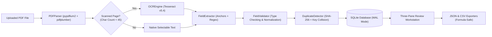

# FormFlow: Intelligent PDF Form Field Extraction Pipeline

[](https://www.python.org/)
[](LICENSE)
[](https://streamlit.io/)
[](https://github.com/tesseract-ocr/tesseract)
[](tests/)
[](#18-security-privacy--local-safety)

> **Day 12 of the "90 Days — 90 Projects" Portfolio Challenge**  
> *A production-minded, privacy-preserving document intelligence workspace for extracting structured form fields, inspecting visual evidence, validating values, and exporting sanitized datasets.*

---

## 1. Project Title & Overview
**Official Title:** Intelligent PDF Form Field Extraction Pipeline  
**Product UI Name:** FormFlow  
**Repository Name:** `90-days-90-projects-day-12-formflow-pdf-extractor`

**FormFlow** is a local-first document processing application that converts unstructured, semi-structured, and scanned PDF forms into verified, structured datasets. Inspired by professional desktop productivity tools, FormFlow features a **Three-Pane Document Review Workstation** (Document Queue, Visual PDF Viewer with Bounding Box Evidence, and an Editable Field Inspector) connected to a deterministic extraction pipeline with automated OCR fallback, SQLite persistence, and formula-injection-safe JSON and CSV exports.

---

## 2. Problem Statement & Motivation
Students, researchers, small business owners, and administrative teams frequently receive recurring PDF forms:
- Invoices and billing receipts with varying line-item layouts.
- Student registrations, grant proposals, and job applications.
- Business contracts and nondisclosure agreements.
- Scanned receipts and image-only document photographs.

Manual data entry is repetitive and error-prone. Conversely, cloud-hosted enterprise Document AI services require paid API keys, credit card setups, vendor lock-in, and transfer sensitive personal and financial data to external servers.

**FormFlow** solves this problem by providing a **100% local, zero-paid-API application** that combines deterministic context matching with Tesseract OCR fallback, allowing users to extract, review, correct, and export structured data entirely on their local workstation.

---

## 3. Objectives & Target Users

### Primary Objectives
1. Provide a reliable, automated pipeline to ingest PDFs, extract key business fields, and detect scanned pages.
2. Deliver a desktop-grade **Three-Pane Review Workstation** for human-in-the-loop review and audit trails.
3. Enforce type-safe validation and normalization (dates to ISO-8601, currency to decimal, phone length checks).
4. Ensure complete local data privacy without sending document contents over the internet.
5. Prevent security hazards such as CSV/Excel formula injection.

### Target Personas
- **Students & Researchers:** Ingesting academic applications and survey forms.
- **Freelancers & Small Business Owners:** Automating monthly invoice bookkeeping.
- **Operations & HR Teams:** Cross-referencing applicant details and vendor records.
- **Data Analysts:** Building structured tabular training sets from unstructured PDF archives.

---

## 4. Key Features

- **Responsive Three-Pane Workstation:**
  - *Left Pane — Document Queue:* Real-time document list, file size, page counts, validation warning badges, and queue management without deleting database history.
  - *Center Pane — PDF Viewer & Evidence:* C++ PDFium-rendered page preview at 160+ DPI, page navigation, bounding box coordinates (`x0, top, x1, bottom`), and raw text inspection tabs.
  - *Right Pane — Extracted Field Inspector:* Editable field cards, instant validation status badges, review status toggling, custom field creation, and one-click reprocessing.
- **Hybrid & Deterministic Extraction Engine:**
  - Context label anchor matching (`Invoice Number:`, `Date:`, `Total:`, `Bill To:`, `Phone:`, `Email:`).
  - Corporate entity heuristic suffix detection (`Inc`, `LLC`, `Corp`, `Solutions`, `Lab`, `University`).
  - Strict regex fallback for emails, international phones, ISO/text dates, and monetary tokens.
  - Deterministic candidate ranking: Preserves alternative candidates in evidence metadata for reviewer selection.
- **Real Scanned Document Detection & Tesseract OCR:**
  - Evaluates page character count heuristics (< 45 characters).
  - Automatically triggers local Tesseract OCR v5.4 on raster pages.
  - In-memory OCR caching to prevent expensive duplicate page rendering.
- **Durable SQLite Persistence & Audit Trail:**
  - Stores metadata in SQLite with Write-Ahead Logging (`WAL`) mode and enforced foreign keys.
  - Tracks user corrections, old values, new values, actions, and UTC timestamps.
  - Keeps binary PDF files in isolated local storage (`data/storage/`) with UUID-prefixed filenames rather than bloated database BLOBs.
- **Dual Duplicate Detection:**
  - *Level 1 (Document):* Cryptographic SHA-256 content hashing to detect identical file uploads.
  - *Level 2 (Business Key):* Cross-document collision detection on key fields (e.g., matching invoice numbers across vendors).
- **Secure Structured Exports:**
  - Documented JSON schema for single documents and multi-document batch containers.
  - Relational (long) and Tabular (wide) CSV formats with UTF-8 BOM encoding for Microsoft Excel.
  - Built-in **Formula Injection Protection:** Automatically escapes leading `=`, `+`, `-`, `@`, `\t`, and `\r` prefixes with single quotes.

---

## 5. User Interface & Screenshots

FormFlow uses a restrained design system with muted blue highlights (`#2563eb`), neutral gray cards (`#f8fafc`), clean borders, and accessible contrast ratios.

```
+---------------------------------------------------------------------------------------------------------+
|  📄 FormFlow — PDF Form Field Extraction Pipeline                     [Theme: Light/Dark] [OCR: Ready]  |
+-------------------+-----------------------------------+-------------------------------------------------+
|  DOCUMENT QUEUE   |       PDF VISUAL VIEWER           |            EXTRACTED FIELD INSPECTOR            |
|                   |                                   |                                                 |
| [➕ Upload PDF]   | [◀ Prev]   Page 1 of 1   [Next ▶] | Document: invoice_sample.pdf     [Completed]   |
|                   |                                   | Template: Invoices & Receipts                   |
| 1. invoice.pdf    | +-------------------------------+ |                                                 |
|    1 pg • 8 flds  | | Apex Cloud Solutions Inc.     | | [Invoice Number] [string]             [Valid]   |
|    [Selected]     | | 100 Tech Blvd, Suite 400      | | Value: [ INV-2026-8891                ]       |
|                   | | San Francisco, CA 94107       | | Excerpt: "Invoice Number: INV-2026-8891"        |
| 2. receipt.pdf    | |                               | | [Save & Validate]  [Verify Field]  [🗑️]       |
|    1 pg • 5 flds  | | INVOICE: INV-2026-8891        | |                                                 |
|    [Select] [✕]   | | Date: 2026-10-15              | | [Date] [date]                         [Valid]   |
|                   | | Bill To: Sophia Sterling      | | Value: [ 2026-10-15                   ]       |
| 3. contract.pdf   | | Total Amount: $1,569.63       | | Normalized: 2026-10-15 (ISO-8601)               |
|    2 pgs • 7 flds | +-------------------------------+ |                                                 |
|    [Select] [✕]   | [Visual]  [Evidence]  [Raw Text]  | [Total Amount] [monetary]             [Valid]   |
|                   |                                   | Value: [ $1,569.63                    ]       |
|                   |                                   | Normalized: 1569.63                             |
|                   |                                   |                                                 |
|                   |                                   | [➕ Add Custom Field]  [⚙️ Reprocess]           |
|                   |                                   | [Export Extracted Data ➡️]                      |
+-------------------+-----------------------------------+-------------------------------------------------+
```

*(Screenshots can be saved into the `screenshots/` directory using standard desktop capture tools).*

---

## 6. Architecture & Data Flow



---

## 7. Technology Stack

| Layer | Component | Version / Library | Purpose |
| :--- | :--- | :--- | :--- |
| **Frontend UI** | Streamlit | `>=1.35.0` | Reactive three-pane document workspace and theme manager |
| **Language** | Python | `3.10`, `3.11`, `3.12` | Core pipeline and business logic |
| **PDF Extraction** | `pdfplumber` | `>=0.11.0` | Token extraction, text lines, and bounding box geometry |
| **PDF Rendering** | `pypdfium2` | `>=4.30.0` | Native Google PDFium C++ rendering at 160+ DPI |
| **OCR Engine** | `pytesseract` | `>=0.3.10` | Local Tesseract OCR v5.4 wrapper with auto-discovery |
| **Image Processing** | Pillow (`PIL`) | `>=10.0.0` | Image enhancement, contrast optimization, and sharpening |
| **Data Processing** | Pandas | `>=2.2.0` | Dataframe manipulation and export generation |
| **Database** | SQLite3 | Python Built-in | Relational metadata, WAL journal mode, and foreign keys |
| **Data Generation** | `reportlab` | `>=4.1.0` | Synthetic test PDF generation for safe portfolio demos |
| **Date Parsing** | `python-dateutil`| `>=2.9.0` | Robust date parsing and ISO-8601 normalization |
| **Test Suite** | `pytest` | `>=8.0.0` | 40 unit and integration tests |

---

## 8. Project Structure

```
90-days-90-projects-day-12-formflow-pdf-extractor/
├── .env.example                     # Environment template
├── .gitignore                       # Git ignore rules for virtualenv, DBs, and temp files
├── LICENSE                          # MIT License
├── README.md                        # Master recruiter & technical documentation
├── QUICKSTART.md                    # 2-minute quick start guide
├── DEMO_SCRIPT.md                   # 90-second portfolio presentation script
├── requirements.txt                 # Pinned Python dependencies
├── pyproject.toml                   # Project metadata and pytest configuration
├── setup.bat                        # Automated 1-click Windows setup script
├── run.bat                          # Automated Windows launch script
├── test.bat                         # Automated test execution script
├── app.py                           # Main Streamlit application entrypoint
├── config.py                        # Path manager, limits, and Tesseract auto-discovery
├── src/
│   ├── __init__.py
│   ├── core/
│   │   ├── __init__.py
│   │   ├── pdf_parser.py            # PDF validation, text extraction, page rendering, word bounding boxes
│   │   ├── ocr_engine.py            # Scanned page detection, Tesseract OCR invocation, caching
│   │   ├── field_extractor.py       # Hybrid context label matching, regex ranking, candidate preservation
│   │   ├── validator.py             # Validation and normalization engine (email, phone, dates, monetary)
│   │   ├── duplicates.py            # SHA-256 document hashing & field-level duplicate detection
│   │   └── pipeline.py              # End-to-end extraction orchestrator service
│   ├── database/
│   │   ├── __init__.py
│   │   ├── db.py                    # SQLite connection, WAL mode, foreign keys, and schema DDL
│   │   └── models.py                # Repositories for documents, fields, templates, and audit logs
│   ├── templates/
│   │   ├── __init__.py
│   │   ├── default_templates.py     # Built-in templates: General Form, Invoices, Applications, Contracts
│   │   └── manager.py               # Template seeding, retrieval, and custom template creation
│   ├── exporters/
│   │   ├── __init__.py
│   │   ├── json_exporter.py         # Documented JSON schema exporter (single & batch)
│   │   └── csv_exporter.py          # Formula-injection-safe CSV exporter (long & wide formats)
│   └── ui/
│       ├── __init__.py
│       ├── theme.py                 # Light/Dark mode CSS palette and responsive layout
│       ├── components.py            # Reusable status badges, metric cards, and cards
│       └── views/
│           ├── __init__.py
│           ├── workspace_view.py    # Page 1: Dashboard overview, recent jobs, upload launcher
│           ├── extract_review_view.py# Page 2: Three-Pane Document Review Workstation
│           ├── history_view.py      # Page 3: Searchable and filterable archive
│           ├── templates_view.py    # Page 4: Template schema manager and regex playground
│           ├── export_view.py       # Page 5: JSON & CSV export generator with live previews
│           └── settings_view.py     # Page 6: System diagnostics, Tesseract test, privacy policy
├── data/
│   ├── README.md                    # Dataset and synthetic PDF documentation
│   ├── sample_pdfs/                 # 5 synthetic test documents
│   │   ├── invoice_sample.pdf
│   │   ├── job_application_sample.pdf
│   │   ├── conference_registration_sample.pdf
│   │   ├── vendor_contract_sample.pdf
│   │   └── scanned_receipt_sample.pdf
│   └── storage/                     # Managed local storage for uploaded PDFs
├── docs/
│   ├── PROJECT_OVERVIEW.md          # Problem statement, scope, and user personas
│   ├── ARCHITECTURE.md              # Detailed architecture, sequence, and ER diagrams
│   ├── USER_GUIDE.md                # Comprehensive user manual
│   ├── DEVELOPMENT_NOTES.md         # Technical decisions and engineering trade-offs
│   ├── TESTING.md                   # Complete test report and methodology
│   └── TROUBLESHOOTING.md           # Windows troubleshooting guide
├── scripts/
│   ├── generate_sample_data.py      # Synthetic PDF generation script
│   └── verify_system.py             # System verification and diagnostics script
└── tests/
    ├── __init__.py
    ├── conftest.py                  # Pytest fixtures and temporary database setup
    ├── test_pdf_parser.py           # Tests for PDF parsing, multipage, empty files, rendering
    ├── test_ocr_engine.py           # Tests for Tesseract availability, preprocessing, caching
    ├── test_field_extractor.py      # Tests for anchor matching, regex fallback, ranking
    ├── test_validator.py            # Tests for types, email, phone, dates, monetary amounts
    ├── test_database.py             # Tests for SQLite persistence, cascade deletion, search
    ├── test_duplicate_detection.py  # Tests for SHA-256 and business key collisions
    └── test_exporters.py            # Tests for JSON schema, CSV formats, formula injection
```

---

## 9. Prerequisites

- **Operating System:** Windows 10 / Windows 11 (or Linux / macOS).
- **Python:** Python `3.10`, `3.11`, or `3.12`.
- **Tesseract OCR (Recommended):**
  - Download official Windows installer: [UB-Mannheim Tesseract Wiki](https://github.com/UB-Mannheim/tesseract/wiki).
  - Install to default: `C:\Program Files\Tesseract-OCR\tesseract.exe`.
  - *Note:* If Tesseract is not installed, FormFlow starts normally and extracts native selectable PDF text without errors.

---

## 10. Step-by-Step Windows Installation

### Option 1: Automated 1-Click Script
Double-click `setup.bat` or run:
```powershell
.\setup.bat
```

### Option 2: Manual Installation via PowerShell
```powershell
# 1. Clone or navigate to the project directory
cd "D:\90 days\90-days-90-projects-day-12-formflow-pdf-extractor"

# 2. Create Python virtual environment
python -m venv .venv

# 3. Activate the virtual environment
.\.venv\Scripts\Activate.ps1

# 4. Install dependencies
pip install -r requirements.txt

# 5. Generate sample PDFs
python scripts\generate_sample_data.py

# 6. Verify installation
python scripts\verify_system.py
```

---

## 11. Quick Start Commands

### Launch FormFlow:
```powershell
.\run.bat
```
FormFlow will open in your browser at `http://localhost:8501`.

### Run Automated Tests:
```powershell
.\test.bat
```

---

## 12. Environment Variables (`.env.example`)

Copy `.env.example` to `.env` to configure custom paths:
```ini
# Application Title & Mode
APP_NAME=FormFlow
APP_TITLE=FormFlow: Intelligent PDF Form Field Extraction Pipeline
APP_ENV=development
DEBUG=False

# Database & Storage
DATABASE_PATH=data/formflow.db
MAX_FILE_SIZE_MB=25
MAX_PAGES_LIMIT=50

# OCR Engine Configuration
# Override only if Tesseract is installed in a non-standard path
# TESSERACT_CMD=C:\Program Files\Tesseract-OCR\tesseract.exe
OCR_DPI=200
SCANNED_PAGE_CHAR_THRESHOLD=45
```

---

## 13. Sample Documents & Synthetic Data

FormFlow includes 5 safe, synthetic test documents in `data/sample_pdfs/`:

1. `invoice_sample.pdf`: Standard business invoice with line items, tax rate, and amounts.
2. `job_application_sample.pdf`: Application form with applicant name, contact info, and organization.
3. `conference_registration_sample.pdf`: Registration pass with international contact number and fee.
4. `vendor_contract_sample.pdf`: 2-page Master Services Agreement with page breaks.
5. `scanned_receipt_sample.pdf`: Pure image-based scanned receipt with **0 selectable text characters**, automatically exercising real Tesseract OCR.

---

## 14. Example Usage: Sample Inputs & Outputs

### Input: `invoice_sample.pdf`
- **File Size:** ~2.5 KB • **Pages:** 1 • **Template:** `Invoices & Receipts`

### Extracted & Normalized Fields:
| Field Name | Extracted Value | Normalized Value | Type | Status | Source Page | Evidence Excerpt |
| :--- | :--- | :--- | :--- | :--- | :--- | :--- |
| `invoice_number` | `INV-2026-8891` | `INV-2026-8891` | `string` | `Valid` | Page 1 | "Invoice Number: INV-2026-8891" |
| `date` | `2026-10-15` | `2026-10-15` | `date` | `Valid` | Page 1 | "Date: 2026-10-15" |
| `organization` | `Apex Cloud Solutions`| `Apex Cloud Solutions`| `string`| `Valid` | Page 1 | "Apex Cloud Solutions Inc." |
| `person_name` | `Sophia Sterling` | `Sophia Sterling` | `string` | `Valid` | Page 1 | "Customer Name: Sophia Sterling" |
| `email` | `billing@apexcloud.io`| `billing@apexcloud.io`| `email`| `Valid` | Page 1 | "Email: billing@apexcloud.io" |
| `phone` | `+1-555-019-2831` | `+1-555-019-2831` | `phone` | `Valid` | Page 1 | "Phone: +1-555-019-2831" |
| `total_amount` | `$1,569.63` | `1569.63` | `monetary`| `Valid`| Page 1 | "Total Amount: $1,569.63" |
| `address` | `450 Innovation Pkwy...` | `450 Innovation Pkwy...` | `string` | `Valid` | Page 1 | "Address: 450 Innovation Parkway..." |

### JSON Output Sample:
```json
{
  "$schema": "formflow-v1.0",
  "document_metadata": {
    "filename": "invoice_sample.pdf",
    "page_count": 1,
    "template": "Invoices & Receipts",
    "processing_status": "completed"
  },
  "fields": [
    {
      "name": "invoice_number",
      "extracted_value": "INV-2026-8891",
      "normalized_value": "INV-2026-8891",
      "data_type": "string",
      "source_page": 1,
      "validation_status": "valid",
      "review_status": "verified"
    },
    {
      "name": "total_amount",
      "extracted_value": "$1,569.63",
      "normalized_value": "1569.63",
      "data_type": "monetary",
      "source_page": 1,
      "validation_status": "valid",
      "review_status": "verified"
    }
  ]
}
```

---

## 15. Testing & Quality Assurance

FormFlow includes an automated test suite executed with `pytest`:

```powershell
.\test.bat
```

### Verified Test Summary:
```
============================= test session starts =============================
platform win32 -- Python 3.12.6, pytest-9.1.1, pluggy-1.7.0
rootdir: D:\90 days\90-days-90-projects-day-12-formflow-pdf-extractor
configfile: pyproject.toml
collected 40 items

tests/test_database.py ....                                              [ 10%]
tests/test_duplicate_detection.py ..                                     [ 15%]
tests/test_exporters.py .......                                          [ 32%]
tests/test_field_extractor.py ....                                       [ 42%]
tests/test_ocr_engine.py .....                                           [ 55%]
tests/test_pdf_parser.py .......                                         [ 72%]
tests/test_validator.py ..........                                       [100%]

============================= 40 passed in 1.63s ==============================
```
**Test Status: 40 Passed / 0 Failed (100% Passing)**

---

## 16. Known Limitations

- **Complex Multi-Column Tables:** Highly nested or borderless multi-column tables are extracted as contiguous text lines; full cell-by-cell table reconstruction requires future spatial heuristics.
- **Handwritten Documents:** Tesseract OCR is optimized for printed typographical characters; cursive or degraded handwriting may require specialized offline vision models.
- **Encrypted / Password-Protected PDFs:** Encrypted documents without user passwords are automatically flagged and rejected during Stage-A validation.

---

## 17. Troubleshooting

- **OCR Engine Offline:** Ensure Tesseract OCR is installed to `C:\Program Files\Tesseract-OCR\tesseract.exe` or set `TESSERACT_CMD` in `.env`.
- **Port 8501 Busy:** Run on an alternate port: `streamlit run app.py --server.port 8502`.
- **Missing Sample PDFs:** Run `python scripts\generate_sample_data.py` to regenerate the synthetic files.
- See [`docs/TROUBLESHOOTING.md`](docs/TROUBLESHOOTING.md) for full solutions.

---

## 18. Security, Privacy & Local Safety

- **Zero Cloud Leakage:** All document processing, OCR, and database transactions execute 100% locally on your machine.
- **CSV Formula Injection Mitigation:** Spreadsheet cells starting with `=`, `+`, `-`, `@`, `\t`, or `\r` are automatically escaped with single quotes (`'`) to neutralize Excel DDE formula attacks.
- **Safe File Naming & Path Traversal Prevention:** Uploaded filenames are sanitized and stored with isolated UUID prefixes in `data/storage/`.
- **No Embedded Script Execution:** FormFlow performs structural parsing only and ignores PDF JavaScript macros and external URL actions.

---

## 19. Future Enhancements

- [ ] Automated visual bounding box highlighting directly overlaid onto rendered canvas images.
- [ ] Lightweight offline layout analysis using YOLO-based form layout detection.
- [ ] Export directly into SQLite-compatible Parquet or DuckDB formats.
- [ ] Automated multi-language OCR pack auto-download wizard.

---

## 20. Learning Outcomes

1. Designed and built a modular document intelligence architecture adhering to clean separation of concerns.
2. Mastered Google PDFium C++ rendering in Python (`pypdfium2`) alongside token bounding box geometry (`pdfplumber`).
3. Integrated real Tesseract OCR v5.4 with image contrast enhancement, unsharp masking, and caching.
4. Implemented relational data modeling in SQLite with WAL mode, foreign keys, and audit logging.
5. Engineered cybersecurity safeguards against CSV formula injection and path traversal attacks.

---

## 21. Technical Skills & Resume Keywords

`Python 3.12` • `Streamlit` • `PDF Processing` • `Tesseract OCR` • `pdfplumber` • `pypdfium2` • `Regular Expressions` • `SQLite3` • `Relational Modeling` • `Data Validation` • `Audit Logging` • `Data Normalization` • `CSV Security` • `Formula Injection Mitigation` • `pytest` • `Automated Testing` • `Software Architecture`

---

## 22. License & Attribution

This project is open-source software licensed under the **[MIT License](LICENSE)** as part of the **90 Days — 90 Projects Challenge** by **Ragu Ram P**.
