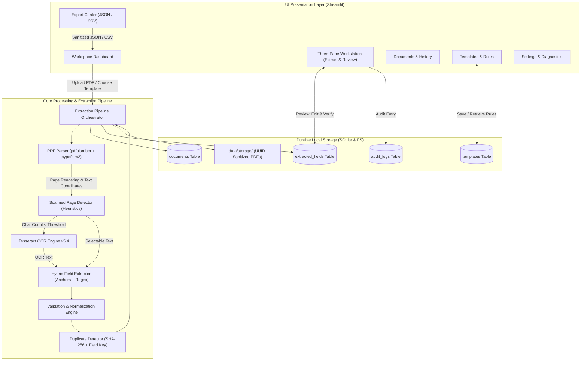
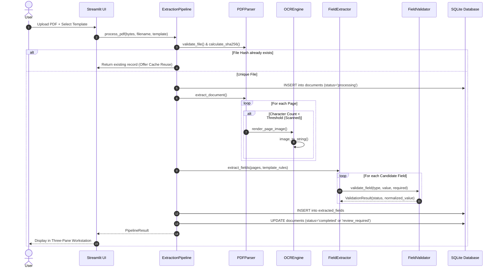
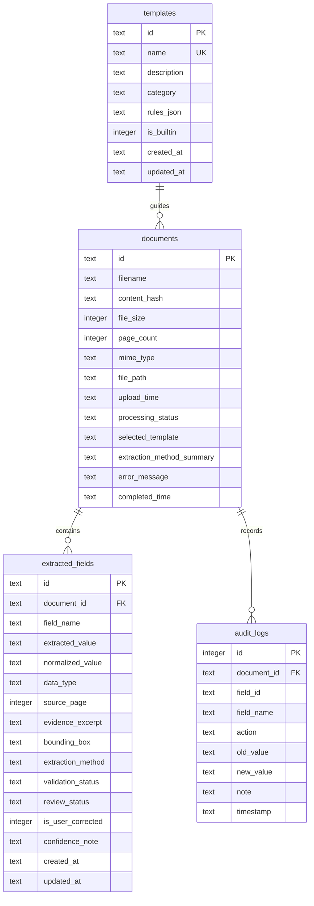

# Architecture & System Design — FormFlow

FormFlow follows a clean, modular 3-tier architecture: Presentation Layer (Streamlit), Core Processing & Business Pipeline, and Data Access Layer (SQLite & Local Storage).

---

## 1. High-Level System Architecture Diagram

---

## 2. Extraction Pipeline Execution Sequence

---

## 3. Database Schema (Entity Relationship Diagram)

---

## 4. Key Architectural Decisions

1. **Dual PDF Engine Approach (`pdfplumber` + `pypdfium2`):**
   - `pdfplumber` parses words and exact bounding box coordinates `[x0, top, x1, bottom]`.
   - `pypdfium2` is Google's C++ PDFium renderer in Python, providing blazing-fast page-to-image rasterization at 160 DPI without requiring Poppler binaries on Windows.
2. **Deterministic-First Extraction:**
   - Rather than unpredictable stochastic prompts, FormFlow employs context label anchors (`Invoice Number:`, `Date:`, `Total:`, `Bill To:`) followed by strict regex validation.
3. **SQLite with WAL Mode (`journal_mode = WAL`):**
   - Enables concurrent reads during background extraction without table locks.
   - Foreign key constraints are explicitly enforced (`PRAGMA foreign_keys = ON;`).
4. **Security & Injection Mitigation:**
   - Formula injection mitigation sanitizes spreadsheet cells starting with `=`, `+`, `-`, `@`.
   - Isolated file storage with UUID prefixes prevents filesystem path traversal attacks.
